# Exploratory analysis findings

The supplied data is cross-sectional. Group comparisons describe this sample. Scenario paths use an assumed 8 percent rate and are not historical trends.

## 01 Price Distribution

The table reports count, spread and percentiles. The overview chart shows the full distribution.

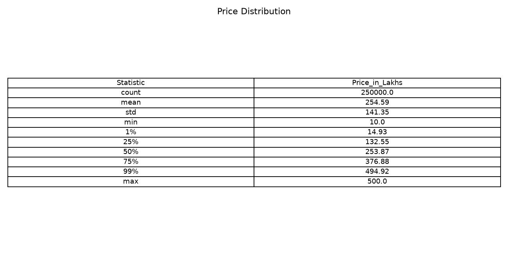

[Full table](eda/01_price_distribution.csv)

## 02 Size Distribution

The table reports count, spread and percentiles. The overview chart shows the full distribution.

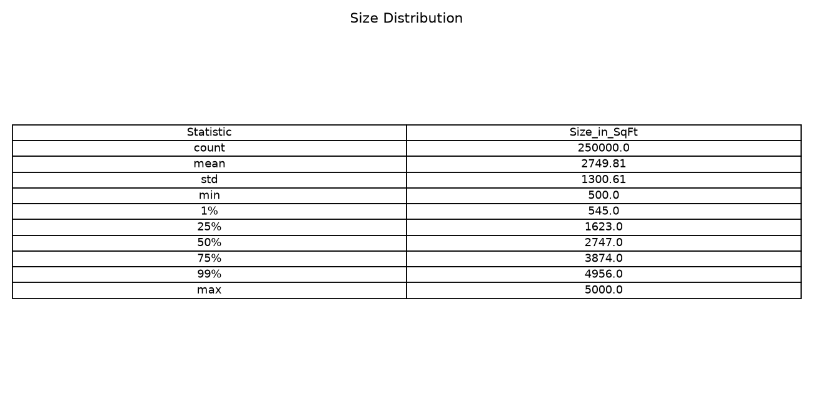

[Full table](eda/02_size_distribution.csv)

## 03 Price Per Sqft By Type

Across 3 reported groups, mean ranges from 13,025.61 to 13,102.05. Highest group: Independent House. Compare sample counts before interpreting differences.

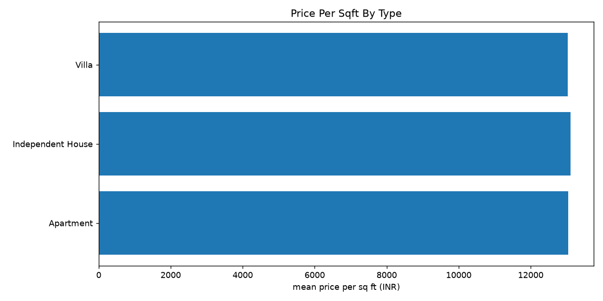

[Full table](eda/03_price_per_sqft_by_type.csv)

## 04 Size Price Correlation

The area-price correlation is approximately -0.0025, showing almost no linear association in this dataset.

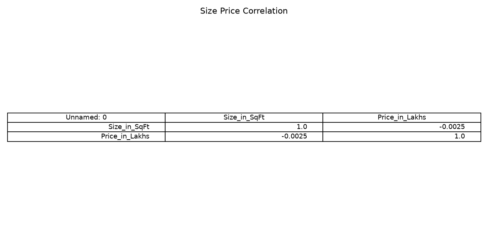

[Full table](eda/04_size_price_correlation.csv)

## 05 Outliers

Across 3 reported groups, count ranges from 0.00 to 116,304.00. Highest group: Flag_Floor_Above_Total. Compare sample counts before interpreting differences. IQR flags are statistical diagnostics, not automatic deletion rules. Floor inconsistencies are separate physical checks.

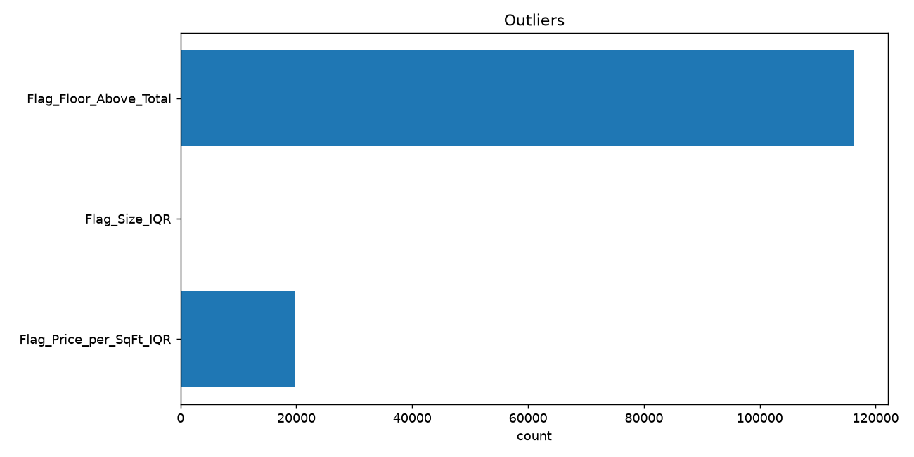

[Full table](eda/05_outliers.csv)

## 06 State Price Per Sqft

Across 20 reported groups, mean ranges from 12,931.49 to 13,252.20. Highest group: Karnataka. Compare sample counts before interpreting differences.

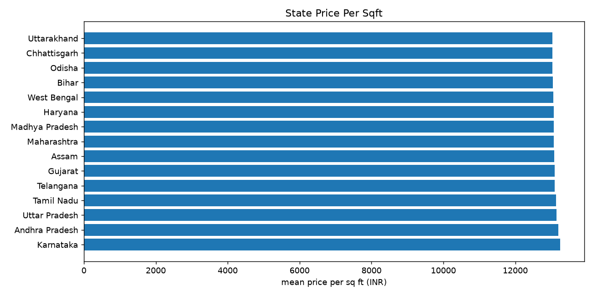

[Full table](eda/06_state_price_per_sqft.csv)

## 07 City Price

Across 42 reported groups, mean ranges from 250.79 to 258.46. Highest group: Bangalore. Compare sample counts before interpreting differences.

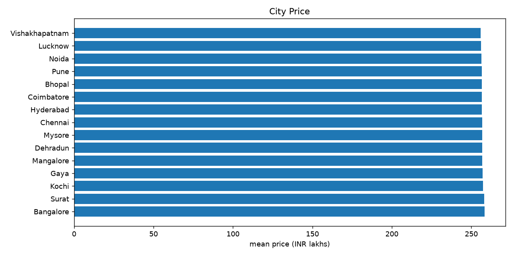

[Full table](eda/07_city_price.csv)

## 08 Locality Age

Across 20,999 reported groups, median ranges from 3.00 to 34.50. Highest group: Karnataka / Mysore / Locality_444. Compare sample counts before interpreting differences.

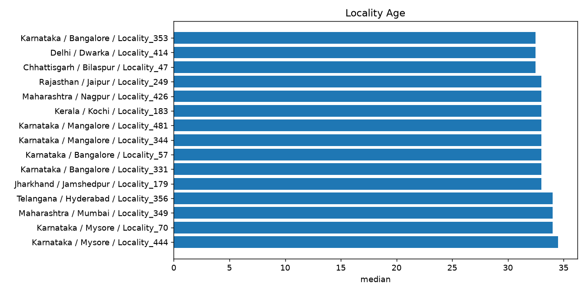

[Full table](eda/08_locality_age.csv)

## 09 City Bhk

The crosstab compares bedroom counts within cities. Counts reflect the supplied sample rather than city housing inventory.

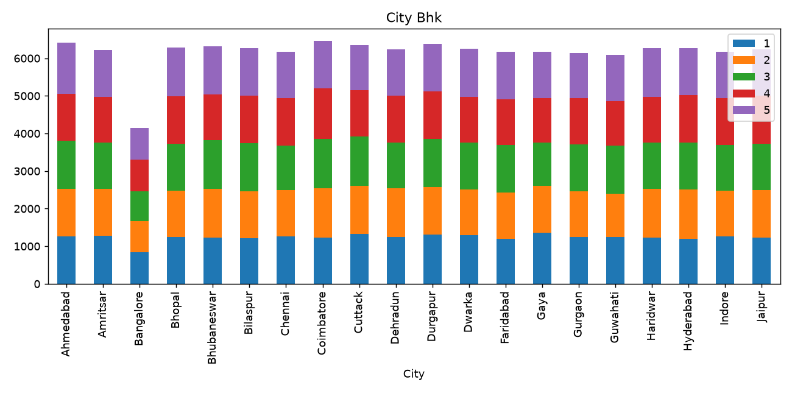

[Full table](eda/09_city_bhk.csv)

## 10 Expensive Localities

Across 5 reported groups, mean ranges from 392.12 to 396.86. Highest group: Maharashtra / Pune / Locality_253. Compare sample counts before interpreting differences. These are the five highest mean-price locality groups with at least ten records. No observed dates are available; projected trends are assumption-based, not historical.

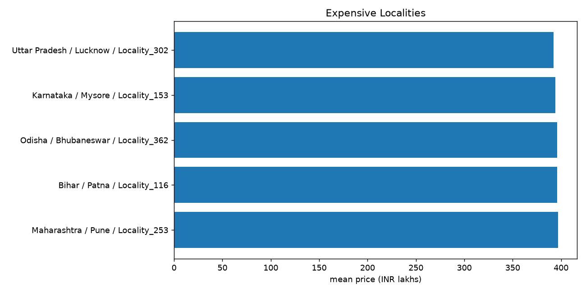

[Full table](eda/10_expensive_localities.csv)

## 11 Numeric Correlations

Correlation describes association. Corrected price per square foot is mechanically derived from price and size. Constant columns can have undefined correlations.

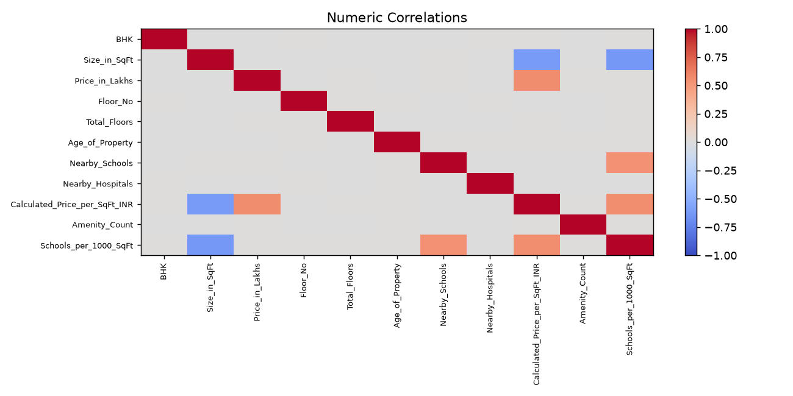

[Full table](eda/11_numeric_correlations.csv)

## 12 Schools

Across 10 reported groups, mean ranges from 12,888.08 to 13,292.36. Highest group: 6.0. Compare sample counts before interpreting differences. Group differences do not prove a causal effect on prices.

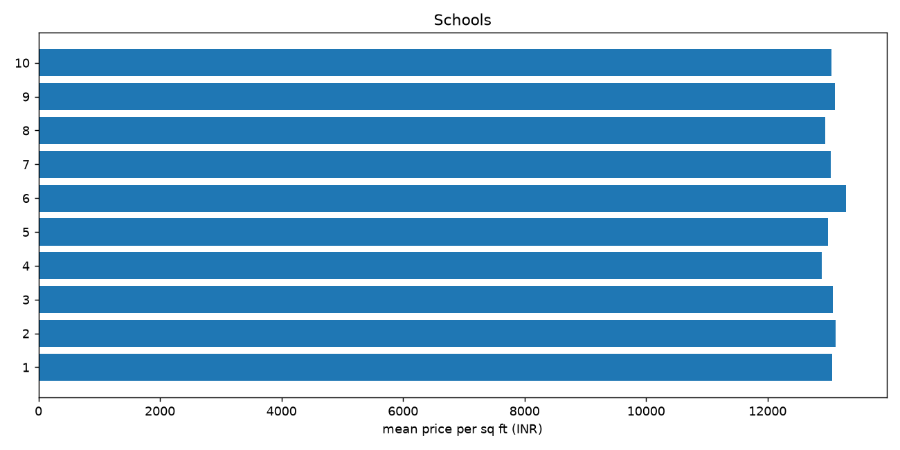

[Full table](eda/12_schools.csv)

## 13 Hospitals

Across 10 reported groups, mean ranges from 12,917.02 to 13,256.91. Highest group: 7.0. Compare sample counts before interpreting differences. Group differences do not prove a causal effect on prices.

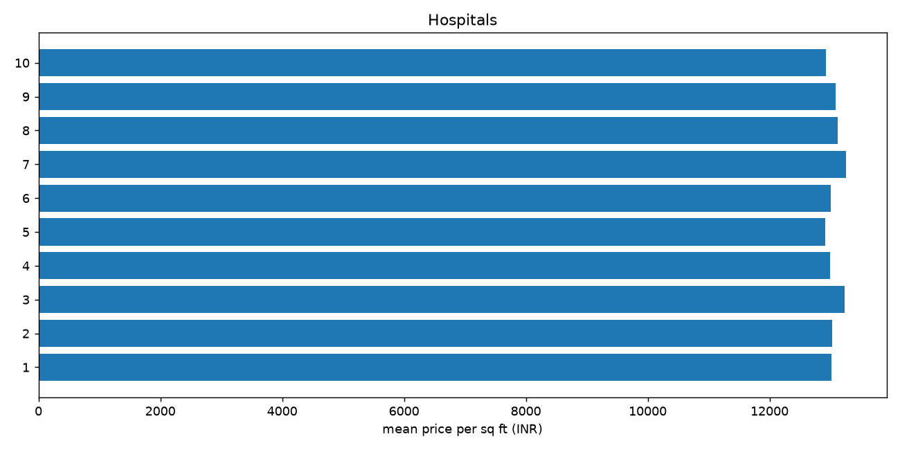

[Full table](eda/13_hospitals.csv)

## 14 Furnishing

Across 3 reported groups, mean ranges from 254.33 to 254.98. Highest group: Unfurnished. Compare sample counts before interpreting differences. Group differences do not prove a causal effect on prices.

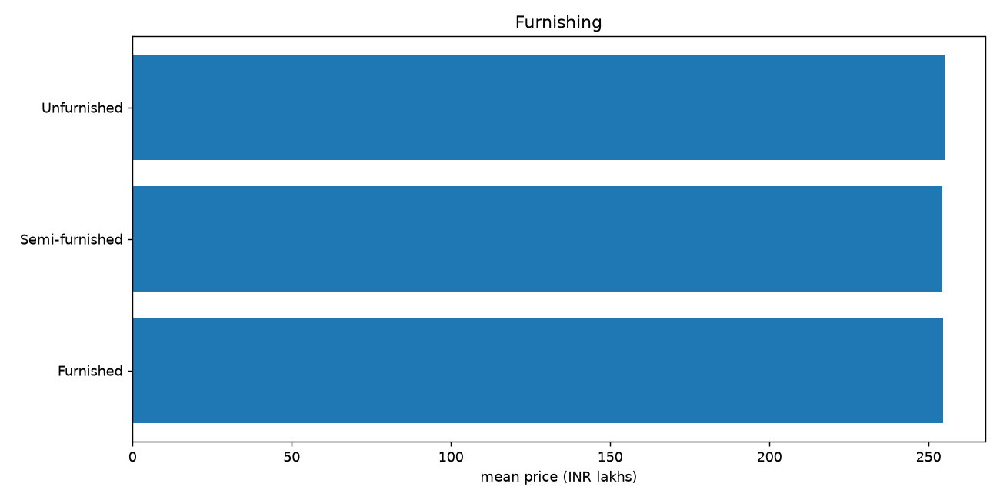

[Full table](eda/14_furnishing.csv)

## 15 Facing

Across 4 reported groups, mean ranges from 13,023.70 to 13,140.02. Highest group: West. Compare sample counts before interpreting differences. Group differences do not prove a causal effect on prices.

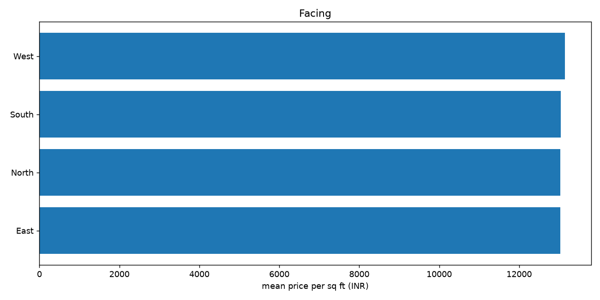

[Full table](eda/15_facing.csv)

## 16 Owner

Across 3 reported groups, count ranges from 83,253.00 to 83,479.00. Highest group: Broker. Compare sample counts before interpreting differences.

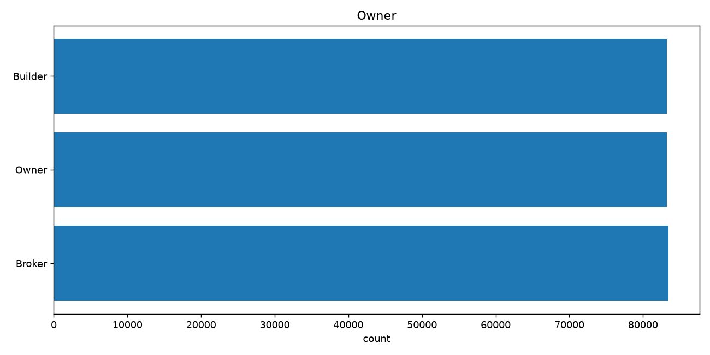

[Full table](eda/16_owner.csv)

## 17 Availability

Across 2 reported groups, count ranges from 124,965.00 to 125,035.00. Highest group: Under_Construction. Compare sample counts before interpreting differences.

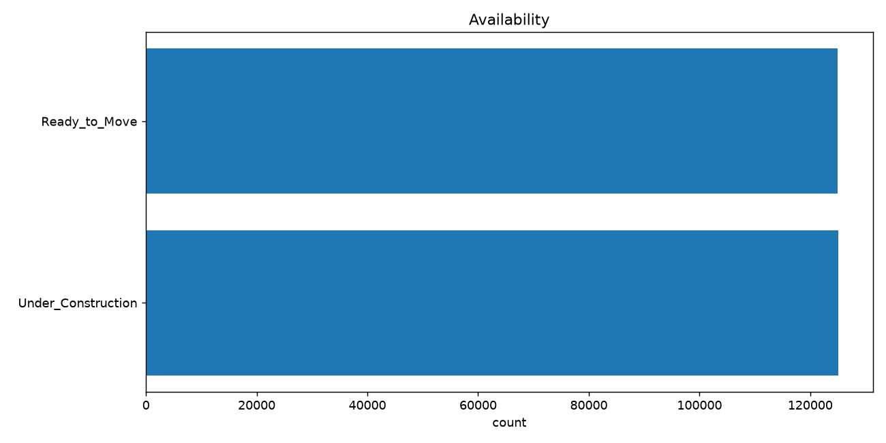

[Full table](eda/17_availability.csv)

## 18 Parking

Across 2 reported groups, mean ranges from 254.43 to 254.75. Highest group: Yes. Compare sample counts before interpreting differences. Group differences do not prove a causal effect on prices.

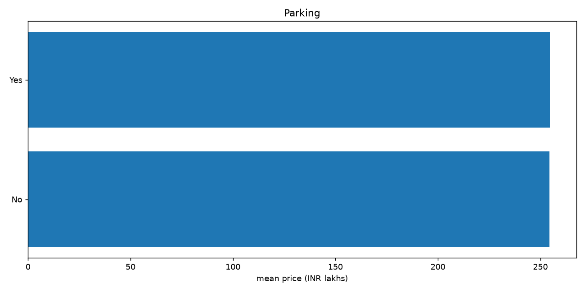

[Full table](eda/18_parking.csv)

## 19 Amenities

Across 31 reported groups, mean ranges from 12,703.07 to 13,446.07. Highest group: Garden, Gym. Compare sample counts before interpreting differences. Group differences do not prove a causal effect on prices.

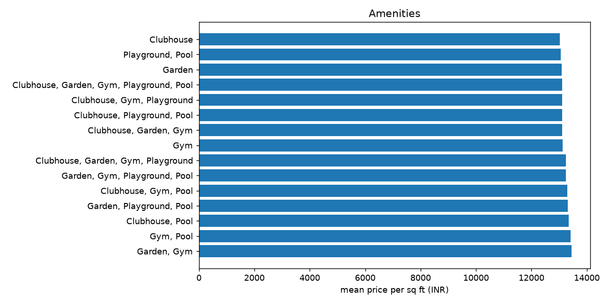

[Full table](eda/19_amenities.csv)

## 20 Transport

Across 3 reported groups, mean ranges from 13,027.24 to 13,085.54. Highest group: Low. Compare sample counts before interpreting differences. Group differences do not prove a causal effect on prices.

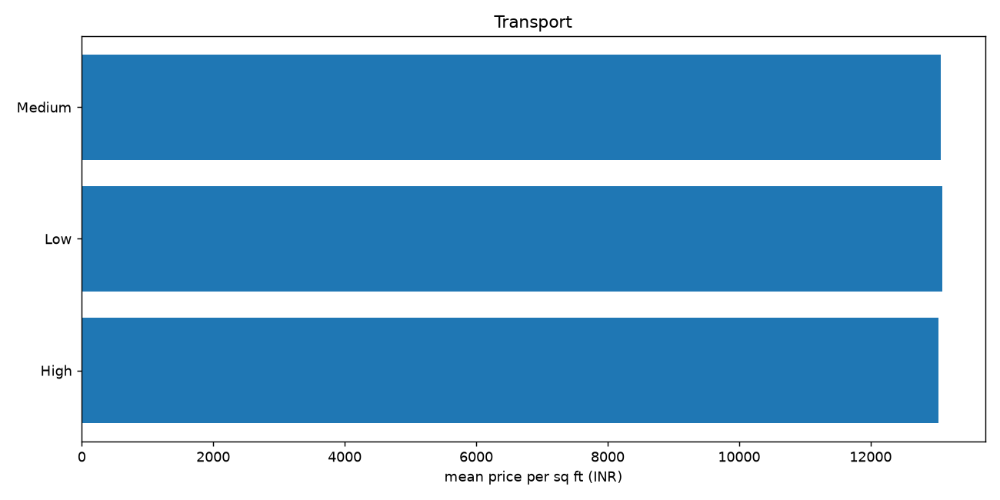

[Full table](eda/20_transport.csv)
